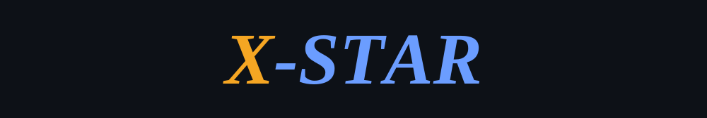

<p align="center">
  
</p>
<h3 align="center">Cross-Lingual Scene Text-Aware Image Retrieval</h3>

<div align="center">

[](docs/resources.md#paper)
[](https://dikshant-sharma05.github.io/X-STAR-website/)
[](docs/resources.md#dataset)
[](docs/resources.md#checkpoints)
[](docs/README.md)


[](LICENSE)

</div>

---

**X-STAR** is a benchmark for cross-lingual scene text-aware image retrieval, with **6,449 images and queries in 13 languages**. Our model, **CoLITE-CLIP**, combines visual features and scene text to retrieve images across languages.

The code supports feature extraction, training, evaluation and retrieval. OCR recognition and translation are upstream preprocessing; supplied English OCR lines and translated queries are the inputs.

## Quick start

Python 3.10+; run from this repository inside a virtual environment:

```bash
git clone https://github.com/vl2g/X-STAR.git
cd X-STAR
pip install -e .
cp configs/paths.example.yaml configs/paths.yaml
# Fill in your manifest, cached-feature and checkpoint paths.
python scripts/retrieve.py --paths configs/paths.yaml \
  --checkpoint xstar_main --query-image-id A_image_103 \
  --query-set hindi_to_english --top-k 5
```

This example needs local data, cached features and a checkpoint; downloads are pending. For extraction, free-text queries and GPU setup, see [installation and usage](docs/usage.md).

## Results

The **original split is the primary release benchmark**. Recall@K (%), macro-averaged over 13 query sets; 1,289 gallery images and 16,757 queries per experiment.

| Split / experiment | Model | R@1 | R@5 | R@10 |
|---|---|---:|---:|---:|
| Original · cached-feature evaluation | **CoLITE-CLIP** | **46.5** | **65.8** | **73.0** |
| Original · cached-feature evaluation | CLIP ViT-B/32 | 24.6 | 42.8 | 52.0 |

The original split contains identical images across splits. Evaluation uses fixed gallery-order ties. [Reports and reproduction limits →](docs/reproduction.md)

## Explore

- [Dataset and preparation](dataset/README.md) — source images, query fields and feature formats.
- [Method and benchmark](docs/method.md) — CoLITE-CLIP and all 13 query languages.
- [Train, evaluate and retrieve](docs/usage.md) — commands and configuration.
- [Project website](https://dikshant-sharma05.github.io/X-STAR-website/) — method, results and retrieval examples.
- [Resources](docs/resources.md) — availability of paper, dataset and checkpoints.

## License and citation

The project's own code and accompanying software documentation are [MIT licensed](LICENSE). Dataset images, annotations, precomputed features and model weights are **not** covered by this code license; see [licensing scope and upstream terms](docs/licensing.md). Paper and citation metadata are [pending](docs/resources.md#citation).

## Acknowledgements

We acknowledge the **National Language Translation Mission ([Bhashini](https://bhashini.gov.in/))** for supporting this project at Indian Institute of Technology Jodhpur.

Built on [Bharat Scene Text Dataset](https://github.com/Bhashini-IITJ/BharatSceneTextDataset), [RCTW-17](https://rctw.vlrlab.net/), [IndicPhotoOCR](https://github.com/Bhashini-IITJ/IndicPhotoOCR), [OpenAI CLIP](https://github.com/openai/CLIP) and the [ColBERT](https://github.com/stanford-futuredata/ColBERT) late-interaction design; pre-trained on [TextCaps](https://textvqa.org/textcaps/).
